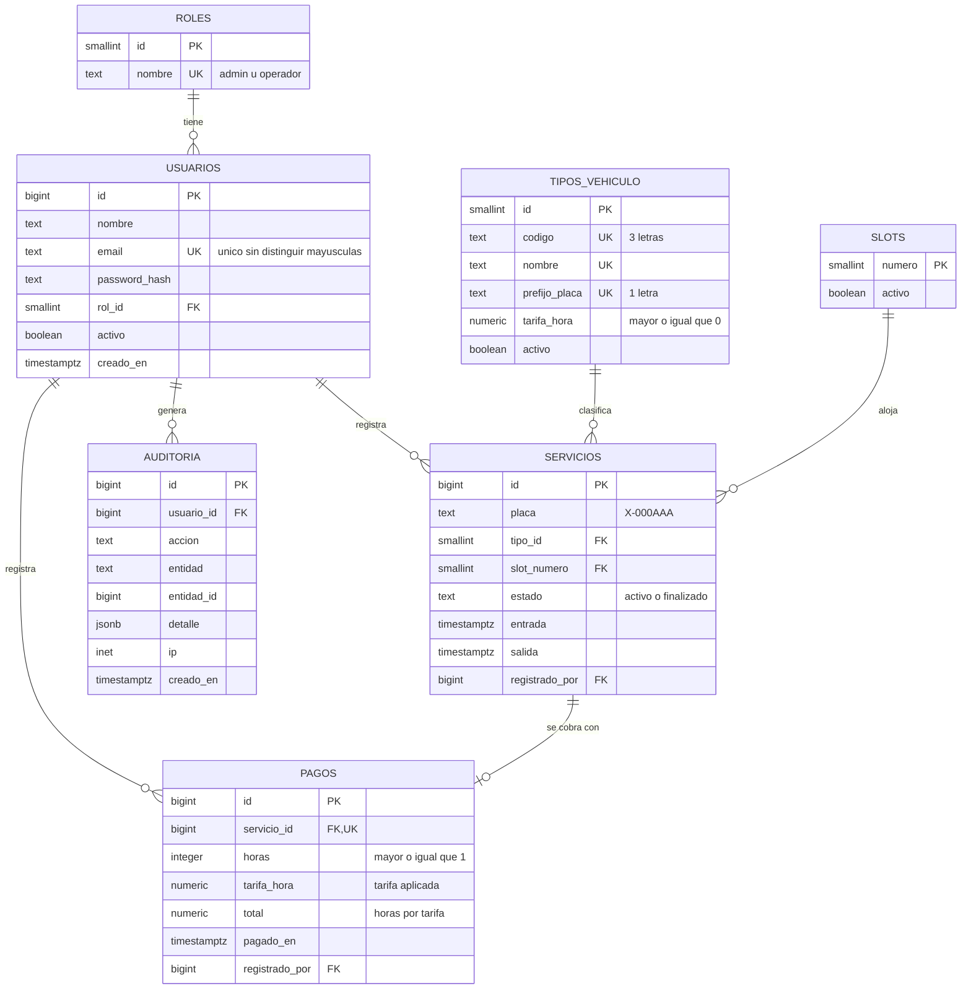

# Diagrama entidad-relación

Esquema de PostgreSQL de SlotSpot MJ. El script que lo crea es `db/schema.sql`.

## Normalización

El esquema está en tercera forma normal: cada dato depende de la clave de su tabla y de nada más. La tarifa vive en `tipos_vehiculo`, y el tipo, el slot y el usuario se referencian por clave foránea.

La única copia intencional es `pagos.tarifa_hora`. Guarda la tarifa vigente al momento del cobro, para que un cambio posterior de tarifa no altere el historial de ingresos.

## Reglas que vigila la base de datos

| Regla | Mecanismo |
|-------|-----------|
| Una placa solo puede tener un servicio activo | Índice único parcial `servicios_placa_activa_unica` |
| Un slot solo puede tener un servicio activo | Índice único parcial `servicios_slot_activo_unico` |
| La placa tiene el formato `X-000AAA` | `CHECK` sobre `servicios.placa` |
| El prefijo de la placa es el del tipo de vehículo | Trigger `servicios_prefijo_placa` |
| La tarifa no puede ser negativa | `CHECK` en `tipos_vehiculo` y `pagos` |
| Un servicio activo no tiene salida y uno finalizado sí, posterior a la entrada | `CHECK` `servicios_salida_coherente` |
| Un servicio finalizado no se edita, no se reabre y no se borra | Trigger `servicios_finalizado_inmutable` |
| Solo se cobra un servicio finalizado, y una sola vez | Trigger `pagos_servicio_finalizado` y `UNIQUE` en `servicio_id` |
| El total cobrado es horas por tarifa | `CHECK` `pagos_total_coherente` |
| La bitácora solo admite altas | Triggers `auditoria_solo_altas` y `auditoria_sin_truncate` |
| Un usuario con historial no se borra, se desactiva | Claves foráneas sin borrado en cascada |

La placa y el slot se reutilizan después de finalizar un servicio, porque los índices únicos solo miran los servicios activos.

## Relación con la aplicación actual

El frontend guarda hoy el `slot` en `null` al dar salida. En la base de datos el slot se conserva en el servicio finalizado como dato histórico, y la disponibilidad se calcula con los servicios activos.
